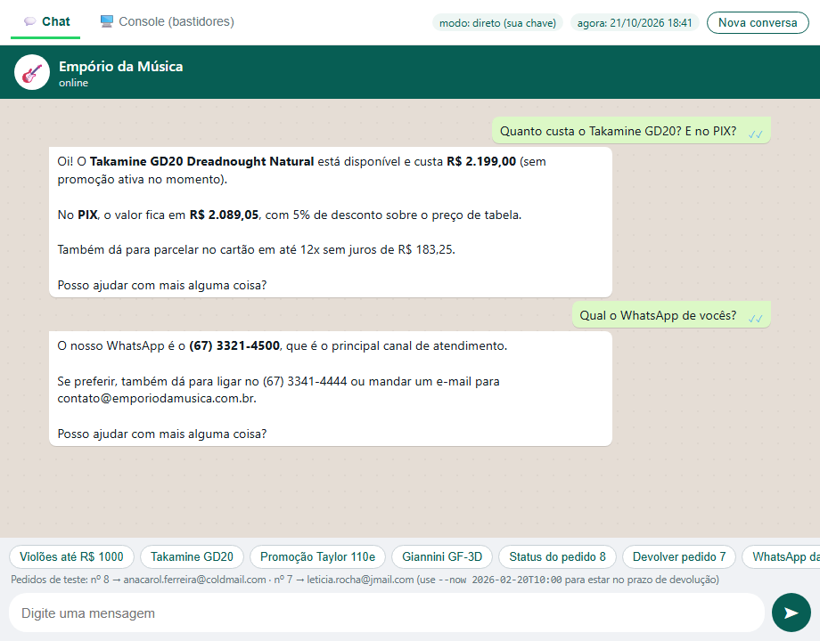
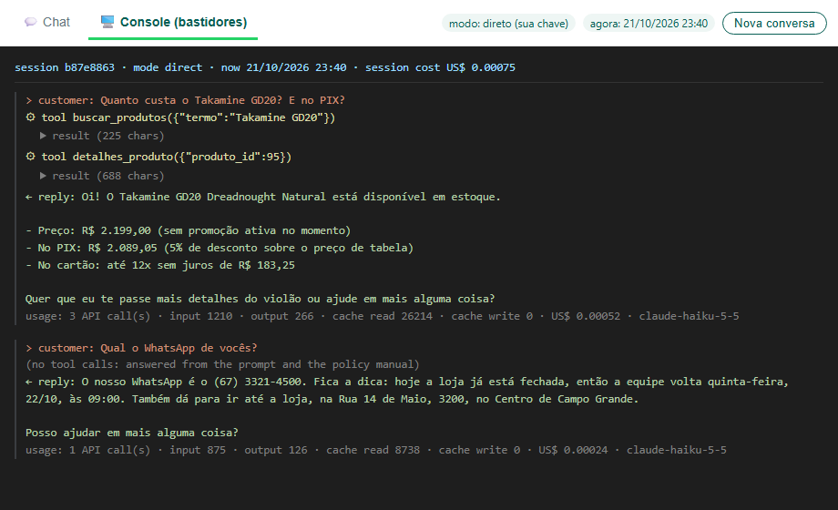
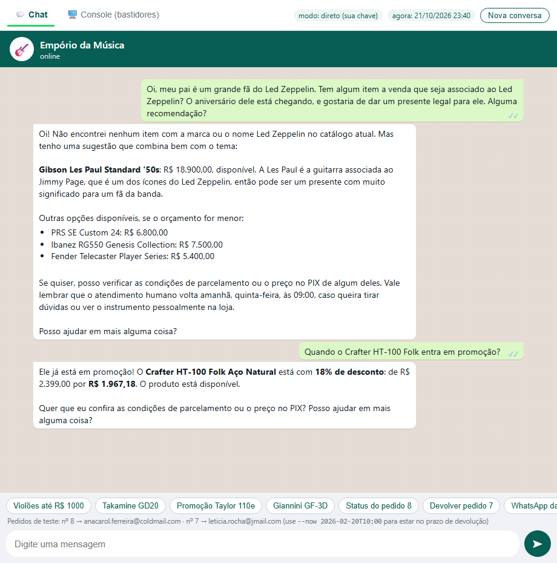
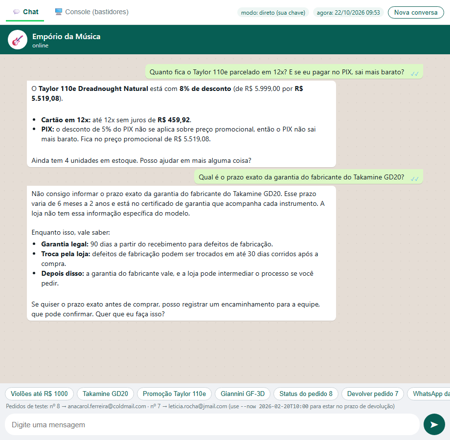
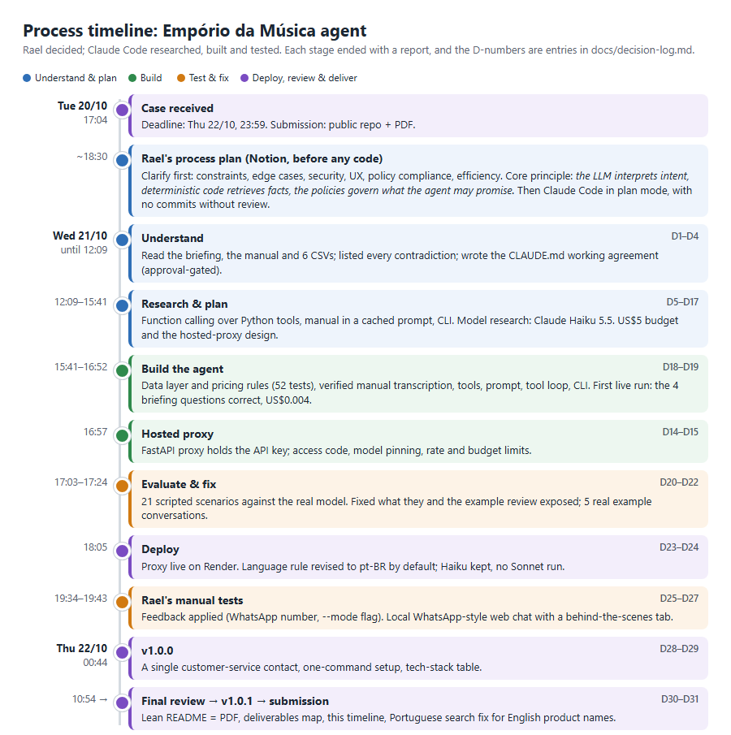

# Empório da Música — AI customer-service agent

A prototype text-message assistant for **Empório da Música**, a fictional musical-instrument
store in Campo Grande/MS, Brazil, built in Python for the Artefact AI Engineer case. It chats in
Brazilian Portuguese, looks up products, prices, stock, promotions and orders in the store's
data, and answers policy questions (hours, payment, returns, shipping, warranty) from the store
manual. It declines what's out of scope, and it never invents prices, rules or customer data.

## Deliverables at a glance
| Requested | Where to find it |
|---|---|
| Public GitHub repository with real commit history | [github.com/rael-peixoto/emporio-da-musica-agent](https://github.com/rael-peixoto/emporio-da-musica-agent) ([commits](https://github.com/rael-peixoto/emporio-da-musica-agent/commits/main)) |
| Python agent: persona, knows when to query data vs. policies, handles out-of-scope questions | `emporio/`, explained in [2. How it works](#2-how-it-works) |
| README: how to run it (environment, model provider, commands) | [1. Quick start](#1-quick-start) |
| README: justification of technical decisions (framework, LLM, retrieval, prompt) | [3. Tech stack & decisions](#3-tech-stack--decisions) (every decision with its trade-offs: [decision log](docs/decision-log.md)) |
| Assumptions made where the case was ambiguous | [4. Assumptions](#4-assumptions) |
| README: known limitations and what I'd do with more time | [7. Limitations & next steps](#7-limitations--next-steps) |
| README: how AI coding assistants were used | [8. How I used AI](#8-how-i-used-ai-claude-code) (process timeline, [`CLAUDE.md`](CLAUDE.md)) |
| 3–5 example conversations, at least one non-trivial | [`examples/`](examples/) (5 real transcripts; 04 and 05 are the non-trivial ones) and 5 chat screenshots in [Quick start](#1-quick-start) |
| PDF of the documentation (e-mail) | This document is the PDF; it was sent through the Google Form |

## 1. Quick start
You need Python 3.11+ (developed on 3.14). Two ways to run it, both using the same agent code:
- **A. Hosted proxy (default, no API key needed):** you run the agent locally, and its model
  calls go through the author's proxy. You need the **access code, which is on the first page
  of the PDF sent through the Google Form**. It is not published here, to protect the API
  budget.
- **B. Your own Anthropic API key (direct mode):** the agent calls Anthropic directly.

The commands below work in both Windows terminals, **Command Prompt (cmd)** and **PowerShell**.
Run them one after another in the same window. **After `cd`, every command must run inside the
`emporio-da-musica-agent` folder**; if you see "No such file: requirements.txt", you're in the
wrong folder.
```
git clone https://github.com/rael-peixoto/emporio-da-musica-agent.git
cd emporio-da-musica-agent
python -m venv .venv
.venv\Scripts\python -m pip install -r requirements.txt     # macOS/Linux: .venv/bin/python
.venv\Scripts\python -m emporio.setup                         # paste the access code (option A)
.venv\Scripts\python -m emporio.web                           # opens the chat in your browser
```
- **No git?** On the GitHub page, click **Code → Download ZIP**, extract it, open a terminal
  in the extracted folder, and start from `python -m venv .venv`.
- **`emporio.setup`** saves the code to `.env`; your typing is hidden. For option B, use
  `emporio.setup --api-key`.
- **Terminal chat instead of the browser:** `.venv\Scripts\python -m emporio` (add `--debug` to
  see tool calls and cost).
- **More options and messages to try:** [technical details](docs/technical-details.md#1-things-to-try).

### Web chat (WhatsApp-style)
The page has two tabs:
- **💬 Chat:** what a customer would see on WhatsApp. Type a question or tap a suggestion
  chip.
- **🖥️ Console (bastidores):** the same conversation behind the scenes: every tool call, the
  exact data the agent received, tokens, cache use and cost.

The server only listens on your own computer (`127.0.0.1`). Press Ctrl+C in the terminal to
stop it.





A harder conversation:
- A gift idea for a Led Zeppelin fan: nothing in the catalogue mentions the band, so the agent
  says so honestly and suggests the Les Paul, the guitar associated with Jimmy Page.
- "When will the Crafter HT-100 go on sale?": it already is, so the agent quotes the active
  18% discount from the data.



Privacy and honesty:
- Asked for another customer's e-mail and phone, the agent refuses (LGPD) without calling any
  tool.
- Asked for a Stradivarius, it says the catalogue has none, and that the orchestral-strings
  category is currently empty. It invents nothing.


Maths and not inventing facts:
- The promotional Taylor 110e comes to 12x of R$ 459,92 (R$ 5.519,08 ÷ 12). The 5% PIX
  discount correctly doesn't stack on the promotion.
- Asked for the *exact* manufacturer warranty, the agent says the data doesn't have it, gives
  the manual's 6-months-to-2-years range, and offers to ask the team.



**Cost:** about US$0.001–0.002 per customer message. In proxy mode, the first message can take
up to a minute while the free server wakes up.

## 2. How it works
```
                ┌─ direct:  Anthropic SDK ──────────────────────────► api.anthropic.com
chat ─► agent ─┤            (your own key)
 (local tools, └─ proxy:   Anthropic SDK, base_url=Render URL ─► FastAPI proxy ─► api.anthropic.com
  local data)              api_key = access code                (key kept server-side)
```
- **The model decides; Python computes.** Claude (Haiku 5.5) decides whether to answer from the
  policy manual or to call a tool. The tools run in Python over the store's CSV files and
  return exact, pre-formatted values, so prices, discounts, installments and deadlines are
  never the model's arithmetic.
- **Policies:** the full 8-page manual is in the system prompt, cached so repeated reads cost a
  tenth.
- **Memory within a conversation:** follow-ups like "E o Fender Stratocaster?" are understood
  from context. Nothing is kept after the session ends (LGPD data minimisation).
- **Language:** pt-BR by default; a customer who writes in English is answered in English.

| Tool | What it does |
|---|---|
| `buscar_produtos` | Product search by term, category, price, string type or electric/acoustic; promotions included |
| `detalhes_produto` | Specs, availability, list and promotional price, PIX price, maximum interest-free installments |
| `listar_categorias` | Categories with their count of available products |
| `consultar_pedido` | Order status, tracking and computed return/warranty deadlines; **needs the order number plus the customer's e-mail or phone** |
| `registrar_atendimento_humano` | Hands complaints and unclear cases to a human, with a protocol number |

## 3. Tech stack & decisions
| Technology | What it does here | Why it was chosen over the alternatives |
|---|---|---|
| **Python 3.14** (3.11+ supported) | The whole project | Required by the briefing |
| **Claude Haiku 5.5** (Anthropic API) | The language model: understands the customer, decides which tool to call, writes the reply | Cheapest current Claude model (US$0.10 / US$0.50 per 1M tokens), and it passed every scenario. GPT-4o-mini costs more and is being retired; Claude 3 Haiku is retired; local Llama 3 8B has no tool calling and too small a context window ([D9](docs/decision-log.md#d9), [D20](docs/decision-log.md#d20)) |
| **Anthropic Python SDK 2.0**, with a hand-written tool loop | Calls the model, runs the tools it asks for, keeps the conversation history | About 40 readable lines. LangChain, LlamaIndex or the SDK's beta tool runner would hide the logic and add dependencies ([D10](docs/decision-log.md#d10)) |
| **Function calling** (5 Python tools over the CSVs) | Looks up products, prices, promotions and orders, and does all the maths | Exact numbers, and customer data only behind a verified lookup. RAG over CSV rows is poor at numeric filters; text-to-SQL could reach personal data ([D5](docs/decision-log.md#d5)) |
| **Policy manual in a cached system prompt** | The model always sees the whole 8-page manual | No retrieval misses; caching makes repeated reads cost a tenth. Embedding RAG is overkill at 8 pages ([D6](docs/decision-log.md#d6)) |
| **Python standard library**: `csv`, `Decimal`, `zoneinfo` (+ `tzdata`) | Loads the data, does exact money maths, works in Campo Grande time | 65 products don't need pandas; `Decimal` avoids rounding errors in prices |
| **Markdown transcription + `pypdf` fidelity test** | The manual as text for the prompt, proven to match the PDF | Readable tables for the model; a test catches any transcription typo |
| **FastAPI + uvicorn** | The hosted proxy and the local web chat | Small, standard, and one framework for both ([D14](docs/decision-log.md#d14), [D26](docs/decision-log.md#d26)) |
| **Render** (free plan, `render.yaml`) | Hosts the proxy that keeps the API key server-side | Free and deploys from GitHub. Sharing a key would be riskier. Trade-off: about 50 s cold start ([D14](docs/decision-log.md#d14)) |
| **Plain HTML/CSS/JavaScript** (one file) | The WhatsApp-style page and its console tab | No build step, CDN or extra package. Streamlit would add dependencies and limit styling ([D26](docs/decision-log.md#d26)) |
| **python-dotenv** + `emporio.setup` | Reads and writes the `.env` settings | Secrets stay out of the code and out of git |
| **pytest** + a custom scenario evaluation | Free unit tests, plus behaviour tests against the real model | The model choice was decided by measured results ([D20](docs/decision-log.md#d20)) |
| **GitHub** (push protection, secret scanning) | Public repository with an incremental history | Required; blocks any push that contains an Anthropic key |
| **python-markdown + headless Chrome** | Builds this PDF from the README | The PDF can't drift from the repository |

All 31 decisions, with the options considered, trade-offs and who decided, are in the
[decision log](docs/decision-log.md).

## 4. Assumptions
The data and the manual contradict themselves in places. Each case gets one explicit rule; where
a rule is ambiguous, it is read in the customer's favour (Brazil's Consumer Protection Code,
art. 47).
1. **What can be sold:** a product must be `active` **and** in stock. For example, 96 is
   "temporarily unavailable", 136 is discontinued despite showing stock, and 130 is "coming
   soon".
2. **Contradictory descriptions are withheld:** for 7 products, the description contradicts
   the product's *own* name or specs. Name, price, stock and specs are treated as
   authoritative (evidence in the table below this list). Searches still find these products:
   Portuguese words also match their English names, so "baixo elétrico" finds the "Electric
   Bass" models ([D31](docs/decision-log.md#d31)).
3. **Promotions:** only active ones count; they don't stack, and the 5% PIX discount never
   applies on top of a promotional price.
4. **Installments:** the detailed §3.1 tiers prevail over the summary table: up to 3x, minimum
   R$ 50 per installment; 4–6x, R$ 80; 7–12x, R$ 100.
5. **Contact:** only **WhatsApp (67) 3321-4500** (§7, "o principal meio de atendimento
   remoto"). The cover's (67) 3341-4444 is assumed to be a business line, and the e-mail is
   spelled two different ways, so neither is given to customers ([D28](docs/decision-log.md#d28)).
6. **Shipping:** an order of exactly R$ 500 ships free (the manual leaves R$ 500 itself
   undefined). Freight to other cities depends on the postcode and isn't quoted.
7. **Returns:** the receipt date is taken to be the estimated delivery date, the only one
   recorded. Orders in the data are treated as online purchases, so the 7-day right to cancel
   applies.
8. **Order records are reported as they are**, even where a total doesn't match its items.
9. **Late orders:** the agent apologises and offers a human.
10. **Empty categories** (woodwinds, brass, orchestral strings): "nothing available right
    now", not "we don't sell it".
11. **Holidays** aren't listed in the manual, so the open/closed check ignores them.
12. **Identity:** order details need the order number plus that customer's e-mail or phone.

Evidence for item 2: each description contradicts the product's own data.

| Product name | Its specs say | Its description says |
|---|---|---|
| 137 Yamaha Bass 3X | 4 strings | "Ibanez… de 5 cordas" |
| 142 Korg Synth 1 Pro | 61 keys | "Roland com 88 teclas" |
| 139 Yamaha Kit 1 | shells: Maple | "Pearl Export… cascos em Poplar" |
| 140 Pearl Kit 2 | shells: Maple | "Tama… cascos 100% Birch" |
| 135 Music Man Bass 1X | body: Ash | "Fender Jazz Bass… corpo em Alder" |
| 136 Ibanez Bass 2X | brand: Ibanez | "Precision" (a Fender model) |
| 144 Roland Synth 3 Pro | brand: Roland | "Teclado arranjador Yamaha" |

## 5. Testing
- **Unit tests:** 138 tests that check the program's own logic, free and in seconds, with no
  AI involved. Examples:
  - the Takamine GD20 costs R$ 2.199,00;
  - PIX never stacks on a promotion;
  - an order is shown only to someone who gives the right e-mail or phone;
  - no tool output ever contains a customer's e-mail or phone.

  Run them with `.venv\Scripts\python -m pytest`.
- **Scenario evaluations,** like a mystery shopper: 24 typical customer messages go to the real
  model, and each answer is checked automatically. Examples: the right price, no other
  customer's data, no discount that shouldn't exist. **24/24 pass**, at about US$0.01 per run.
  The [report](evals/results/claude-haiku-5-5.md) includes every conversation.
- Every example and screenshot was also checked by hand against the data. The detail and the
  honest notes on how the suite evolved are in
  [technical details](docs/technical-details.md#5-testing--evaluation).

## 6. Security & cost
- **The API key never leaves the server.** Reviewers' model calls go through a small proxy
  that requires the access code.
- **The proxy can only act as this assistant:** it enforces its own model, system prompt,
  tools and output-length cap.
- **Spending is capped at several layers:** request-size and rate limits, a US$1/day proxy
  budget, a US$3/month Anthropic workspace limit, and a US$5 prepaid balance with no
  auto-reload.
- **No secrets in git:** keys live in `.env` (gitignored), and GitHub push protection is on. A
  scan of the full history found no key or access code.
- **Privacy (LGPD):** customer data is reachable only through a verified order lookup, and the
  logs hold no message content.

Full safeguards table: [technical details](docs/technical-details.md#3-security--cost-safeguards).

## 7. Limitations & next steps
**Limitations**
- **Tone:** sometimes merely objective rather than the warm "friend who knows music" the manual
  asks for.
- **Wording slips:** rare, such as a gendered word inferred from a name. Facts come from tools,
  so prices, dates and rules weren't affected.
- **Identity check:** weak where two customers share an e-mail (ids 11 and 43).
- **Dates:** return windows use the *estimated* delivery date, and holidays aren't modelled.
- **No real WhatsApp:** the web chat only looks like it. The free proxy also sleeps when idle.

**With more time**
- Connect to the real WhatsApp Business API: a webhook on the same server, reusing the agent
  ([design](docs/technical-details.md#7-real-whatsapp-integration-design)).
- Use past promotion names (Black Friday, Páscoa…) as seasonal hints, once the store confirms
  they recur ([D29](docs/decision-log.md#d29)).
- A stronger identity check (one-time code), and more evaluation scenarios run on every change.
- A local model (e.g. via Ollama) as a zero-cost option; retrieval if the manual grows.

## 8. How I used AI (Claude Code)
About 1.5 hours after the case arrived, before opening any tool, I wrote my process plan in
Notion. Its core principle became the architecture: **the LLM interprets the customer's intent,
deterministic code retrieves the facts, and the policies govern what the agent may promise.**

I then worked with **Claude Code** (Anthropic's coding assistant) under a written working
agreement, [`CLAUDE.md`](CLAUDE.md): understand → research → plan → build → test → document.
- **I made every product and technical decision.** Claude Code researched options, proposed
  plans, wrote the code and ran the tests.
- **Approved plans** are kept in [`docs/`](docs/).
- **Every commit was gated** on passing tests and an automatic secret scan.
- **My own manual testing** changed the design several times: the contact channel, the
  language rule, the web chat and the search fix.



## 9. Repository map
```
emporio/    the agent: cli.py and web.py (+ static/) interfaces · agent.py loop · tools.py ·
            prompt.py · catalog.py and rules.py (data, pricing) · llm.py · setup.py · config.py
proxy/      FastAPI proxy that holds the API key (deployed on Render via render.yaml)
knowledge/  verbatim Markdown transcription of the policy manual
data/       case data provided by Artefact (unchanged)
examples/   five real conversation transcripts
evals/      scenario evaluations and their latest report
tests/      unit tests
docs/       decision log, technical details, approved plans, images
scripts/    PDF build and timeline source
CLAUDE.md   the working agreement followed by the AI assistant
```
